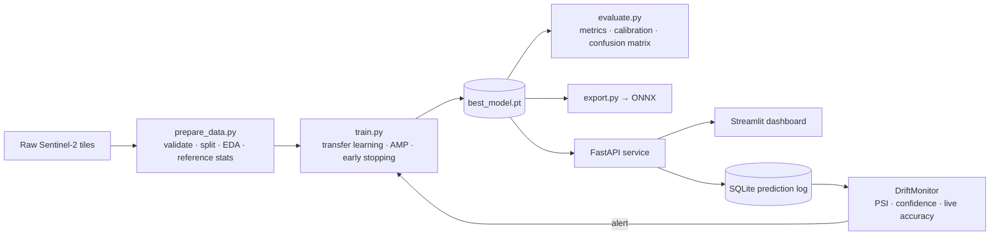

# 🛰️ GeoVision — End-to-End Deep Learning for Satellite Land-Use Classification

**Authors:** Shashank Mishra · Saksham Srivastava — Major Project, Deep Learning

**Result:** EfficientNet-B0 reaches **94.5% test accuracy** (macro-F1 0.945) on 4,050 held-out Sentinel-2 images.

An end-to-end deep learning system. It starts from raw Sentinel-2 satellite imagery and ends with a monitored production service.

**Real-world problem.** Governments, insurers and agri-tech companies need up-to-date land-use maps. They use them for urban planning, deforestation tracking, crop monitoring and flood-risk assessment. Labelling satellite tiles by hand doesn't scale. GeoVision classifies each 64×64 Sentinel-2 tile into one of 10 land-use classes and explains every decision. It also tells you when incoming imagery has drifted away from what the model was trained on.

| Stage | What's implemented |
|---|---|
| **Raw data** | EuroSAT RGB, which has 27,000 Sentinel-2 tiles in 10 classes. It downloads automatically. |
| **Preprocessing** | Integrity check that removes corrupt files, a reproducible *stratified* 70/15/15 split, a data-quality report, EDA figures and training-set reference statistics for drift detection |
| **Augmentation** | Random resized crop, H/V flips, 90° rotations (satellite images have no "up"), colour jitter and MixUp |
| **Models** | A CNN trained from scratch as the baseline, plus transfer learning with ResNet-50, EfficientNet-B0 and ConvNeXt-Tiny |
| **Training** | Two-stage fine-tuning (frozen-backbone warmup, then full fine-tune), discriminative learning rates, AdamW, cosine LR, label smoothing, AMP mixed precision, gradient clipping, early stopping and best-checkpoint saving |
| **Validation** | Macro-F1 on the validation set after every epoch drives model selection and early stopping |
| **Evaluation** | Accuracy, macro and weighted F1, top-3 accuracy, per-class report, confusion matrix, calibration (ECE and reliability diagram), most-confident mistakes, latency benchmark and test-time augmentation |
| **Explainability** | A from-scratch Grad-CAM heatmap for every prediction |
| **Experiment tracking** | An `experiments/runs.csv` registry, an ablation script with a model leaderboard and optional MLflow |
| **Deployment** | A FastAPI REST service (single and batch prediction, feedback endpoint), a Streamlit dashboard, ONNX export with a parity check, Docker and docker-compose |
| **Monitoring** | Every request is logged to SQLite. PSI-based data drift and prediction drift, a low-confidence rate, live accuracy from user feedback and a Prometheus `/metrics` endpoint |
| **Engineering** | A YAML config with CLI overrides, a pytest suite covering data, models, monitoring and the API, plus GitHub Actions CI |

## Architecture



## Project structure

```
geovision/
├── configs/config.yaml        # every hyper-parameter lives here
├── src/geovision/
│   ├── data.py                # download, validation, stratified split, transforms, loaders
│   ├── models.py              # baseline CNN + ResNet50 / EfficientNet-B0 / ConvNeXt-T
│   ├── train.py               # training loop
│   ├── evaluate.py            # test-set metrics, calibration, latency
│   ├── explain.py             # Grad-CAM
│   ├── inference.py           # Predictor class used by the API
│   ├── export.py              # ONNX export + verification
│   ├── monitoring.py          # prediction store + drift detection
│   └── plots.py               # all report figures
├── app/api.py                 # FastAPI service
├── app/dashboard.py           # Streamlit UI
├── scripts/                   # prepare_data · compare_models · simulate_traffic
├── tests/                     # pytest suite (runs without the real dataset)
├── docs/PROJECT_REPORT.md     # write-up for viva / interviews
├── Dockerfile, docker-compose.yml, .github/workflows/ci.yml
```

## Run the demo (Windows, already set up)

Double-click **`run_demo.bat`**. It starts the server and opens the web app at http://127.0.0.1:8000:

| Page | What you can do |
|---|---|
| **Classify** | Drop, browse or paste (Ctrl+V) an image, or click a test image. See the class, a confidence ring, top-k probabilities and the Grad-CAM heatmap (overlay with an opacity slider, or side by side). Confirm or correct the prediction, copy the JSON, download the heatmap. |
| **Batch** | Upload up to 500 images (or add 20 test images), classify with progress, then filter, sort and export to CSV. |
| **Monitoring** | Live KPIs, drift status, noise-corrected PSI per image statistic, a confidence chart and recent requests. Use *Simulate 60 normal / drifted requests* to demonstrate the drift alarm, *Auto-refresh*, and *Reset log*. |
| **Model report** | Test metrics, model details, training curve, per-class precision/recall/F1 and every evaluation figure (click to enlarge). |
| **Help** | Quick start and what each number means. Keys `1`–`5` switch pages. |

The older Streamlit dashboard is still available: `streamlit run app/dashboard.py`.

## Quick start (Windows / Linux, NVIDIA GPU recommended)

```bash
python -m venv .venv
.venv\Scripts\activate            # Linux/macOS: source .venv/bin/activate

# 1) PyTorch with CUDA (GPU). For CPU only, use .../whl/cpu instead
pip install torch torchvision --index-url https://download.pytorch.org/whl/cu124
pip install -r requirements.txt
pip install -e .

# 2) Data: download, validate, split, EDA
python scripts/prepare_data.py

# 3) Train (EfficientNet-B0 by default) - evaluates on the test set automatically
python -m geovision.train
#    try other models / settings without editing files:
python -m geovision.train --set model.name=resnet50 train.batch_size=32 train.epochs=10

# 4) Explainability gallery + ONNX export
python -m geovision.explain
python -m geovision.export

# 5) Serve
uvicorn app.api:app --port 8000          # API docs at http://localhost:8000/docs
streamlit run app/dashboard.py           # UI at http://localhost:8501

# 6) Demo monitoring: normal traffic, then drifted traffic
python scripts/simulate_traffic.py --n 200
python scripts/simulate_traffic.py --n 200 --drift dark

# Tests
pytest -q
```

**Ablation study** (trains all four models and prints a leaderboard): `python scripts/compare_models.py --epochs 10`

**Docker** (after training): `docker compose up --build`. The API is on port 8000 and the dashboard on port 8501.

On a 4 GB GPU such as a GTX 1650, the defaults (EfficientNet-B0, 128 px, batch 64, AMP) fit in memory. For ResNet-50 or ConvNeXt, use `train.batch_size=32`. If memory runs out, lower `model.img_size` or the batch size.

## Results

Fill this table in from `artifacts/test_metrics.json` and `experiments/leaderboard.csv` after you train.

| Model | Params | Test acc | Macro-F1 | ECE | Latency (ms/img) |
|---|---|---|---|---|---|
| Baseline CNN (scratch) | 1.2 M | | | | |
| ResNet-50 | 23.5 M | | | | |
| EfficientNet-B0 (5 epochs, CPU, 64 px) | 4.0 M | **94.5%** | **0.945** | 0.187 | 12.6 |
| ConvNeXt-Tiny | 27.8 M | | | | |

Figures generated in `artifacts/`:
- `eda_class_distribution.png`
- `eda_samples.png`
- `training_curves.png`
- `confusion_matrix.png`
- `reliability_diagram.png`
- `misclassified.png`
- `gradcam_examples.png`

## API example

```bash
curl -F "file=@tile.jpg" "http://localhost:8000/predict?explain=false&top_k=3"
```
```json
{"label": "Forest", "confidence": 0.98, "top_k": [...], "latency_ms": 12.4, "request_id": "..."}
```

## Dataset citation
Helber et al., *EuroSAT: A Novel Dataset and Deep Learning Benchmark for Land Use and Land Cover Classification*, IEEE JSTARS 2019.
