<div align="center">


<br>

[](https://github.com/shashankmishra23/geovision-landuse-dl/actions/workflows/ci.yml)


[](LICENSE)

**Classify satellite images into 10 land-use classes, see *why* the model decided, and get alerted when live data drifts.**

[Demo](#-demo) · [Features](#-features) · [Results](#-results) · [Quick start](#-quick-start) · [How it works](#-how-it-works) · [API](#-rest-api) · [Team](#-team)

</div>

---

## 🎬 Demo

<div align="center">
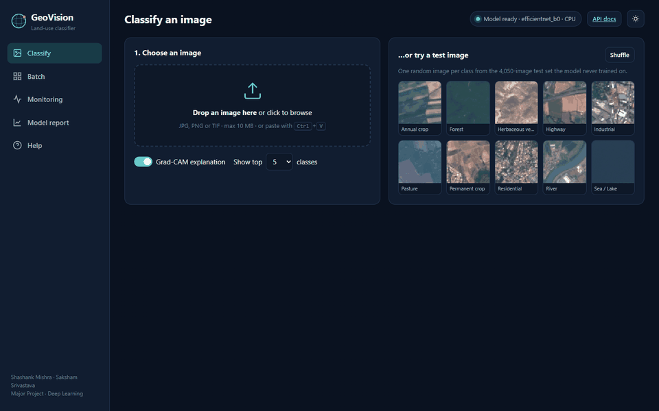
<br><sub>Classify → Grad-CAM heatmap → batch of 20 → drift alarm → model report (recorded from the real app)</sub>
</div>

## ✨ Features

| | Feature | In one line |
|:-:|---|---|
| 🛰️ | **Land-use classification** | EfficientNet-B0 fine-tuned on 27,000 Sentinel-2 tiles, 10 classes |
| 🔥 | **Explainable AI** | Grad-CAM heatmap shows which pixels drove each prediction |
| 🖥️ | **Web app** | Drag-and-drop, batch upload, CSV export, dark/light theme |
| 📡 | **Drift monitoring** | Noise-corrected PSI raises an alert when input imagery changes |
| ✅ | **Human feedback** | Confirm or correct predictions to track live accuracy |
| ⚡ | **Production API** | FastAPI REST service, ONNX export (4.7× faster on CPU), Dockerfile |
| 🧪 | **Tested** | 20 automated tests, run on every push by GitHub Actions |

## 📸 Screenshots

<table>
<tr>
<td width="50%">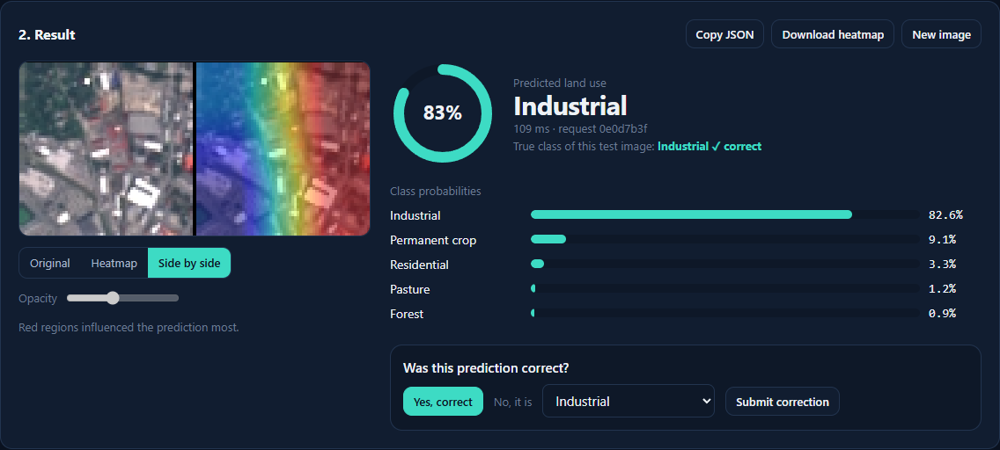<br><b>Classify</b> — prediction, confidence, side-by-side Grad-CAM</td>
<td width="50%">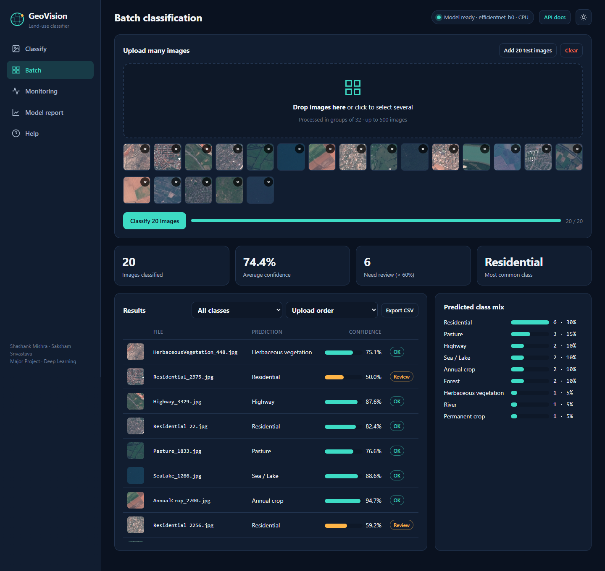<br><b>Batch</b> — 20 images at once, review flags, CSV export</td>
</tr>
<tr>
<td width="50%">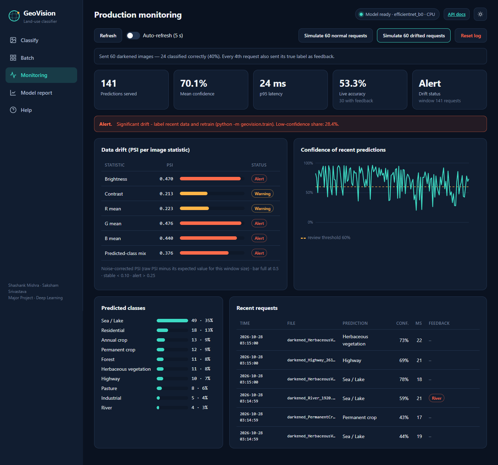<br><b>Monitoring</b> — drift alert after darkened images</td>
<td width="50%">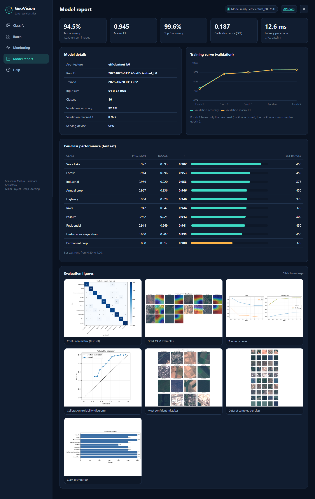<br><b>Model report</b> — metrics, training curve, per-class F1</td>
</tr>
</table>

<details>
<summary><b>More screenshots</b> (light theme, stable monitoring, full classify page)</summary>
<br>

| Light theme | Monitoring — normal traffic |
|---|---|
| 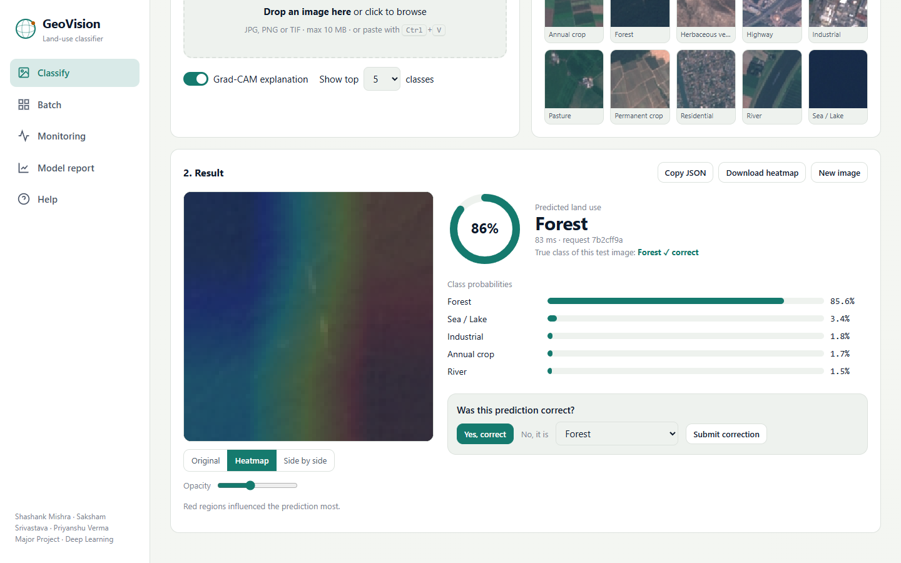 | 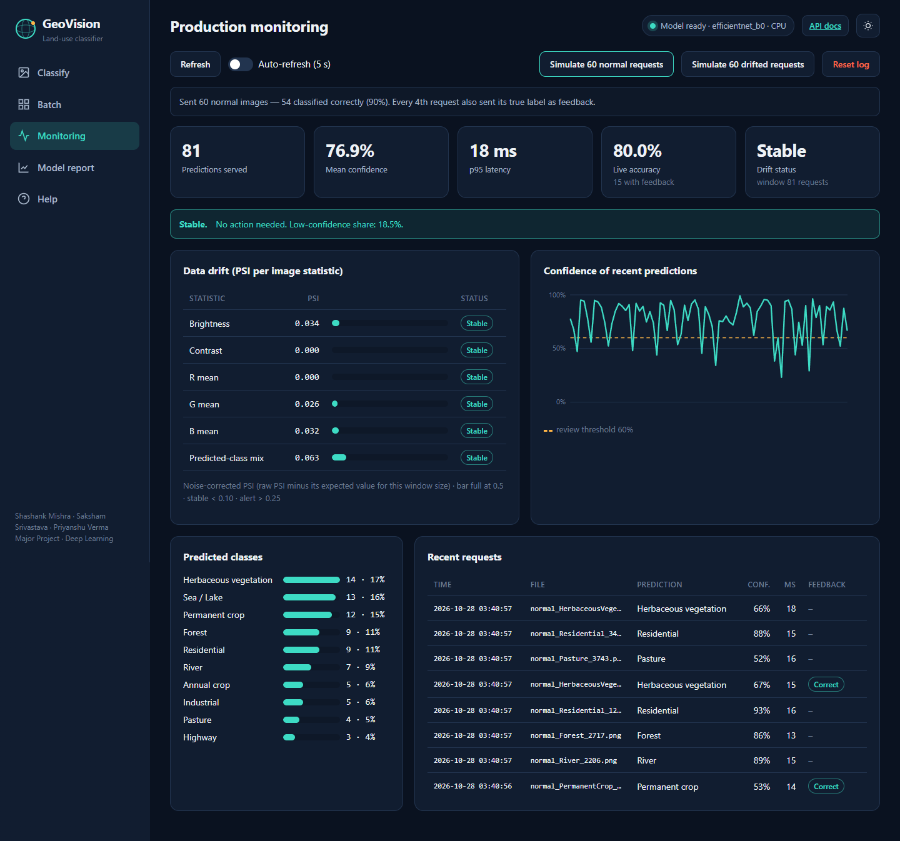 |

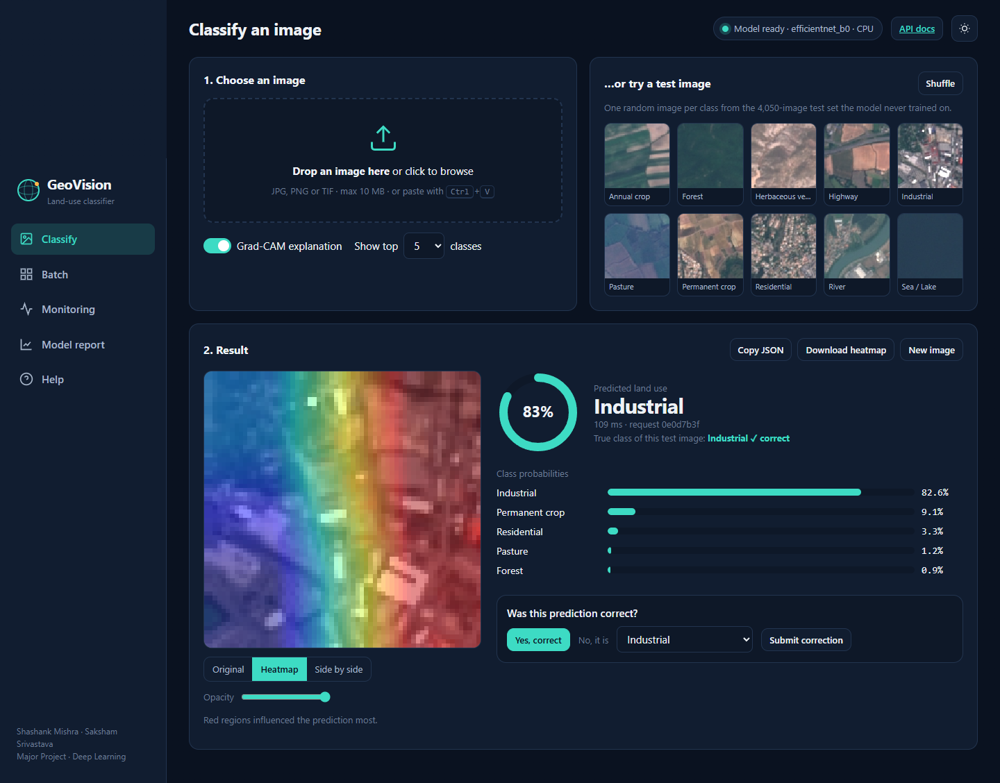
</details>

## 📊 Results

Evaluated on **4,050 test images** the model never saw during training or model selection.

<div align="center">

| Accuracy | Macro-F1 | Top-3 accuracy | Latency (CPU) | Model size |
|:-:|:-:|:-:|:-:|:-:|
| **94.5%** | **0.945** | **99.6%** | **12.6 ms** / image | **4.0 M** params |

</div>

<table>
<tr>
<td width="50%">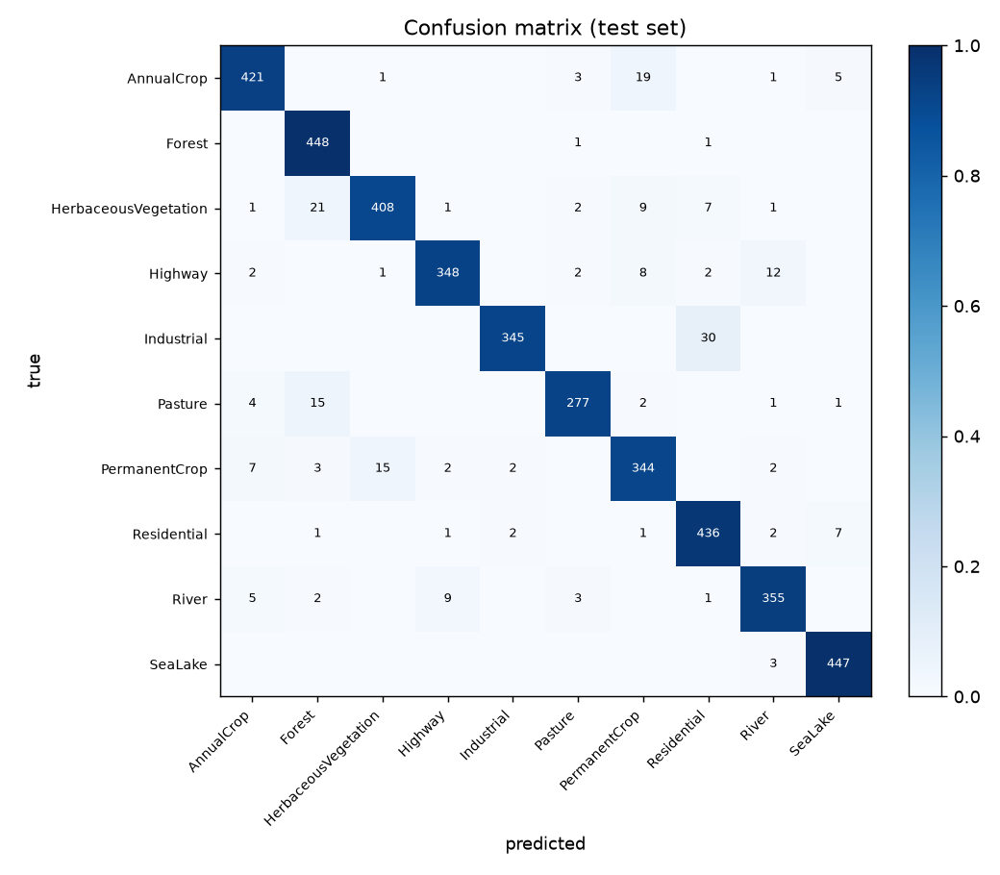</td>
<td width="50%">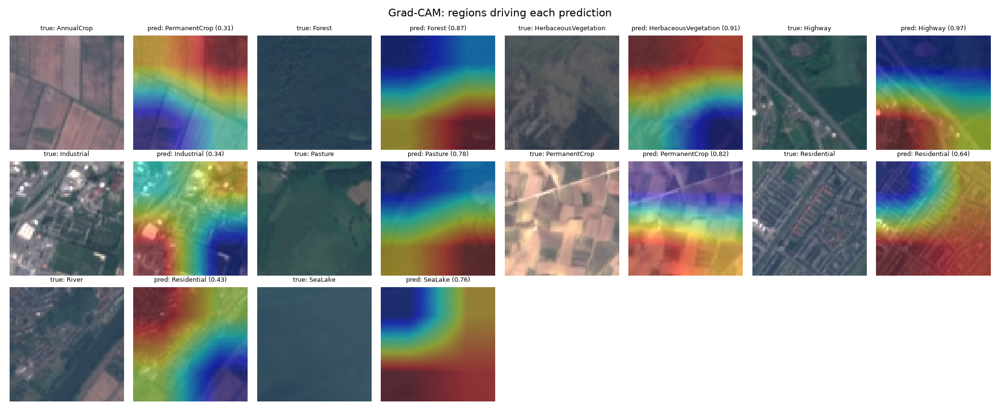<br><br>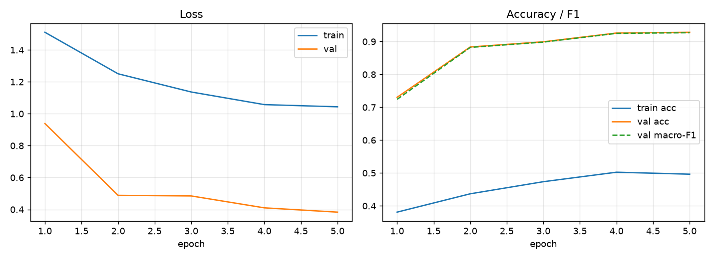</td>
</tr>
</table>

<details>
<summary><b>Per-class scores</b></summary>
<br>

| Class | Precision | Recall | F1 |
|---|:-:|:-:|:-:|
| Sea / Lake | 0.972 | 0.993 | **0.982** |
| Forest | 0.914 | 0.996 | 0.953 |
| Industrial | 0.989 | 0.920 | 0.953 |
| Annual crop | 0.957 | 0.936 | 0.946 |
| Highway | 0.964 | 0.928 | 0.946 |
| River | 0.942 | 0.947 | 0.944 |
| Pasture | 0.962 | 0.923 | 0.942 |
| Residential | 0.914 | 0.969 | 0.941 |
| Herbaceous vegetation | 0.960 | 0.907 | 0.933 |
| Permanent crop | 0.898 | 0.917 | 0.908 |

Most errors are between look-alike classes — Industrial → Residential (30), Herbaceous → Forest (21), Annual → Permanent crop (19).
</details>

<details>
<summary><b>Honest limitations</b></summary>
<br>

- Trained for **5 epochs on a CPU at 64 px** (the GPU driver did not support CUDA 12.6); a longer GPU run at 128 px is the path to ≥ 0.97 macro-F1.
- **Calibration** (ECE 0.187) misses its < 0.03 target: the model is *under*-confident (76% mean confidence at 94.5% accuracy), a known effect of MixUp + label smoothing. Temperature scaling is the planned fix.
- Trained on European imagery; other regions need fine-tuning.
</details>

## 🚀 Quick start

```bash
git clone https://github.com/shashankmishra23/geovision-landuse-dl.git
cd geovision-landuse-dl
python -m venv .venv
.venv\Scripts\activate                 # macOS / Linux: source .venv/bin/activate
pip install torch torchvision --index-url https://download.pytorch.org/whl/cpu
pip install -r requirements.txt
pip install -e .
python scripts/prepare_data.py         # optional: downloads the dataset for the built-in test images
uvicorn app.api:app --port 8000        # then open http://127.0.0.1:8000
```

The trained model is included in `artifacts/`, so **no training is needed** to run the app.

<details>
<summary><b>Other ways to run</b></summary>
<br>

| How | Command |
|---|---|
| **Windows one-click** | double-click `run_demo.bat` |
| **VS Code** | open the folder → **F5** → *GeoVision: Web app* |
| **Docker** | `docker compose up --build` (Dockerfile provided; not built as part of this project) |
| **Retrain** | `python -m geovision.train` — defaults reproduce the reported model (64 px, 5 epochs) |
| **Evaluate** | `python -m geovision.evaluate` |
| **Compare models** | `python scripts/compare_models.py --epochs 10` |
| **Export ONNX** | `python -m geovision.export` |
| **Tests** | `pytest -q` |
| **Drift demo (CLI)** | `python scripts/simulate_traffic.py --n 150 --drift dark` |
</details>

## 🧠 How it works

<div align="center"></div>

| Stage | What happens |
|---|---|
| **Data** | 27,000 EuroSAT tiles, every file verified, stratified 70/15/15 split (seed 42) |
| **Preprocess** | 90° rotations and flips (satellite images have no “up”), crop, colour jitter, MixUp |
| **Train** | Two stages: frozen backbone (epoch 1, 73%) → full fine-tune (epochs 2–5, 92.8% val) |
| **Evaluate** | Accuracy, macro-F1, top-3, ECE calibration, confusion matrix, Grad-CAM |
| **Deploy** | FastAPI service + web app, ONNX export, Dockerfile |
| **Monitor** | Every request logged; noise-corrected PSI vs. training data. Measured: 60 normal images → **Stable** (PSI 0.00); +60 darkened → **Alert** (brightness PSI 0.54) |

<details>
<summary><b>Model architecture</b></summary>
<br>

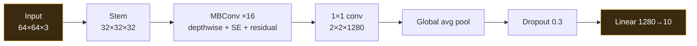

ImageNet-pretrained EfficientNet-B0 backbone + our classification head (orange). 4.0 M parameters.
</details>

<details>
<summary><b>Training configuration</b></summary>
<br>

| Setting | Value |
|---|---|
| Optimiser | AdamW, weight decay 1e-4 |
| Learning rate | head 1e-3, backbone 1e-4 (discriminative) |
| Schedule | Cosine annealing to 1e-6 |
| Batch · input | 64 · 64×64 RGB |
| Loss | Cross-entropy, label smoothing 0.1 |
| Regularisation | MixUp α 0.2, dropout 0.3, gradient clipping 5 |
| Selection | Best validation macro-F1, early stopping (patience 4) |
| Hardware · time | CPU · 22 minutes total |
</details>

<details>
<summary><b>Request lifecycle</b></summary>
<br>

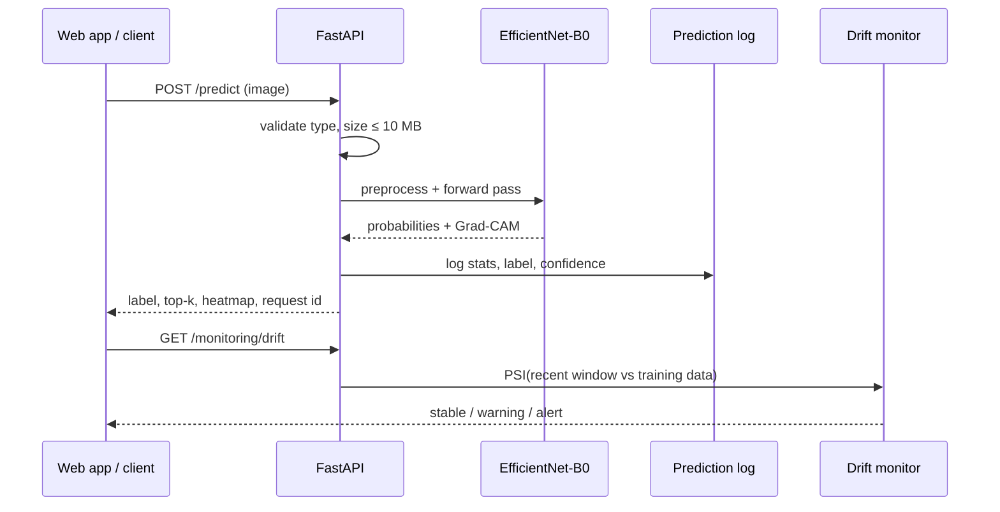
</details>

## 🔌 REST API

Interactive docs at **`/docs`** once the server is running.

| Method | Endpoint | Purpose |
|---|---|---|
| `POST` | `/predict` | Classify one image (`?top_k=5&explain=true` adds Grad-CAM) |
| `POST` | `/predict/batch` | Classify up to 32 images |
| `POST` | `/feedback` | Attach the true label to a past prediction |
| `GET` | `/monitoring/summary` · `/recent` · `/drift` | Traffic, latency, live accuracy, drift report |
| `DELETE` | `/monitoring` | Reset the prediction log |
| `GET` | `/model-info` · `/model/report` | Model details, test metrics, history |
| `GET` | `/health` · `/metrics` | Liveness and Prometheus metrics |
| `GET` | `/samples` · `/samples/{id}` | Random held-out test images (used by the web app) |
| `GET` | `/artifacts/{name}` | Evaluation figures (confusion matrix, Grad-CAM, …) |
| `GET` | `/` | The web app |

<details>
<summary><b>Example</b></summary>

```bash
curl -F "file=@tile.jpg" "http://127.0.0.1:8000/predict?top_k=3"
```
```json
{
  "label": "Industrial",
  "class_index": 4,
  "confidence": 0.784,
  "top_k": [
    {"label": "Industrial", "probability": 0.784},
    {"label": "AnnualCrop", "probability": 0.041},
    {"label": "Forest", "probability": 0.035}
  ],
  "latency_ms": 211.5,
  "request_id": "aa0f4b09e3e64eaca7d6f8c09183afa9"
}
```
<sub>Real response for `Industrial_10.jpg` (first request after start-up, so latency includes warm-up).</sub>
</details>

## 📁 Project structure

<details>
<summary><b>Show tree</b></summary>

```
geovision-landuse-dl/
├── app/
│   ├── api.py                 # FastAPI service (REST endpoints + web app)
│   ├── static/index.html      # single-page web app
│   └── dashboard.py           # legacy Streamlit dashboard
├── src/geovision/
│   ├── data.py                # download, validation, stratified split, transforms
│   ├── models.py              # EfficientNet-B0, ResNet-50, ConvNeXt-T, baseline CNN
│   ├── train.py               # two-stage fine-tuning loop
│   ├── evaluate.py            # metrics, calibration, latency
│   ├── explain.py             # Grad-CAM (from scratch)
│   ├── monitoring.py          # prediction store + noise-corrected PSI drift
│   ├── export.py              # ONNX export + parity check
│   └── inference.py · plots.py · config.py
├── artifacts/                 # trained model, metrics, figures
├── configs/config.yaml        # every hyper-parameter
├── scripts/                   # prepare_data · compare_models · simulate_traffic · capture_screenshots
├── tests/                     # 20 pytest tests
├── docs/                      # project report + README assets
└── Dockerfile · docker-compose.yml · run_demo.bat
```
</details>

## 🗺️ Roadmap

- [x] End-to-end pipeline: data → training → evaluation → deployment → monitoring
- [x] Grad-CAM explanations in the API and web app
- [x] Noise-corrected PSI drift detection with live feedback
- [x] ONNX export (verified against PyTorch) and Dockerfile
- [x] GitHub Actions CI running all 20 tests
- [ ] GPU training at 128 px (target macro-F1 ≥ 0.97)
- [ ] Temperature scaling for calibrated confidence
- [ ] All 13 Sentinel-2 spectral bands
- [ ] Pixel-level segmentation (U-Net) for full maps

## 👥 Team

<table>
<tr>
<td align="center"><a href="https://github.com/shashankmishra23"><br><b>Shashank Mishra</b></a><br><sub>@shashankmishra23</sub></td>
<td align="center"><a href="https://github.com/Saksham653"><br><b>Saksham Srivastava</b></a><br><sub>@Saksham653</sub></td>
<td align="center"><a href="https://github.com/priyanshuverma1765-beep"><br><b>Priyanshu Verma</b></a><br><sub>@priyanshuverma1765-beep</sub></td>
</tr>
</table>

Major Project · Deep Learning. A detailed write-up is in [`docs/PROJECT_REPORT.md`](docs/PROJECT_REPORT.md).

## 📚 Acknowledgements

- Dataset: Helber et al., *EuroSAT: A Novel Dataset and Deep Learning Benchmark for Land Use and Land Cover Classification*, IEEE JSTARS 2019.
- EfficientNet: Tan & Le, ICML 2019. Grad-CAM: Selvaraju et al., ICCV 2017.

<div align="center">

**If you found this project useful, please consider giving it a ⭐**

<sub>Released under the [MIT License](LICENSE).</sub>

</div>
